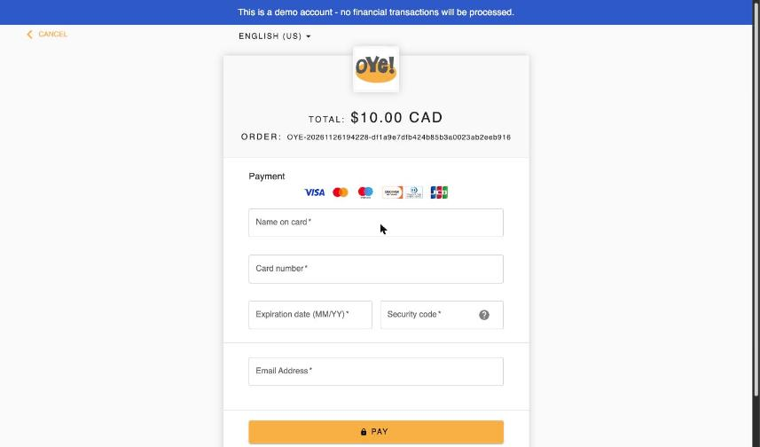
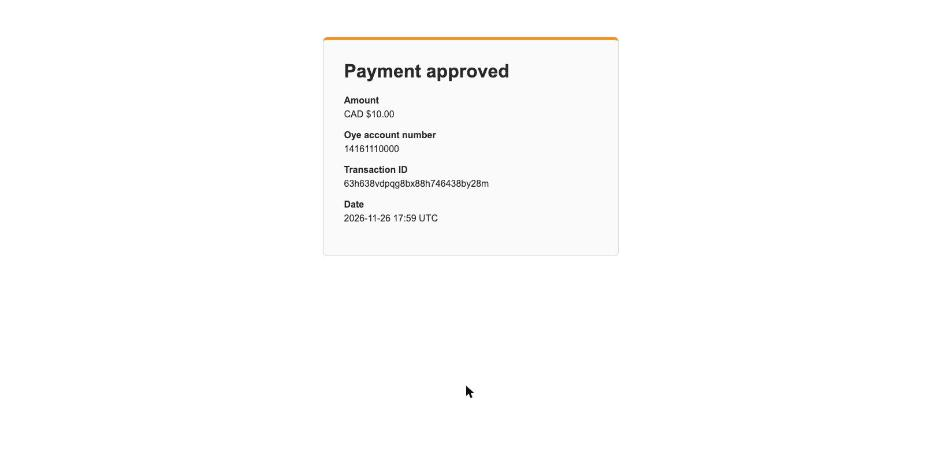
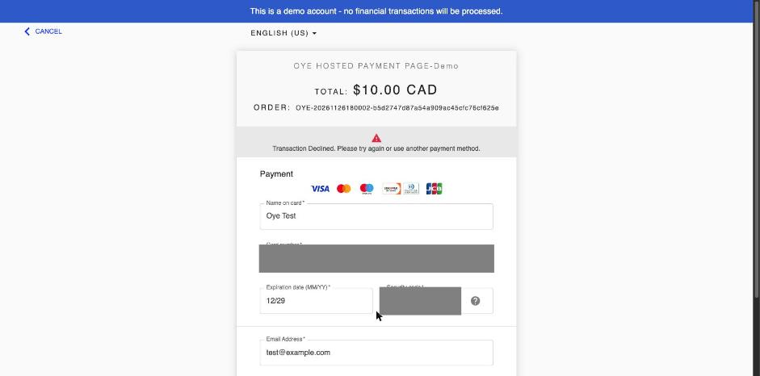

# Oye hosted payment page (Elavon)

Standalone "Pay online" page for oyemobile.ca using the Elavon Payment Gateway hosted payment page. Tested on the Elavon sandbox in CAD: approved, declined and cancelled payments.

## Screenshots

| Elavon payment page | Payment approved | Card declined |
| --- | --- | --- |
|  |  |  |

## Files

- `site/` – files for the website (Web Forms, same style as FAQs.aspx)
- `testhost/` – small test app used to run the same code on a Mac

## Deploy

1. Copy `PayOnline.aspx`, `PayOnlineReturn.aspx` (with their `.aspx.cs` files) and `PayOnline.css` into one folder, for example `/pay/`. The pages link to each other relatively, so any folder works.
2. Copy `ElavonGateway.cs` and `OyeCheckout.cs` into the site's **root** `App_Code/` folder (ASP.NET only compiles `App_Code` at the application root, not inside `/pay/`).
3. The pages use `~/site/site.master`, its `cphHead` and `cphBody` placeholders, and `BasePage`, the same as `FAQs.aspx`.
4. No web.config changes are needed: the Elavon **sandbox (test) keys** are hardcoded in `ElavonGateway.cs` (`SandboxHost`, `SandboxMerchantAlias`, `SandboxSecretKey`). For live, load the keys from the database in `ElavonGateway.Create()`.
5. Open `https://www.oyemobile.ca/pay/PayOnline.aspx`.

## Checkout in five steps

1. Set the app's HostedPayUrl to the site's absolute PayOnline.aspx?acct=[UserName] URL and substitute the URL-encoded account number. The shopper can edit the account and choose a CAD amount. Minimum and Maximum are in OyeCheckout.cs.
2. The server validates both fields and creates an Elavon order with a unique OYE reference.
3. It creates a payment session, saves the reference, account, amount and session ID in ASP.NET Session, then redirects the browser to Elavon for card entry.
4. Cancellation returns to the form. On return, the server looks up the original attempt in the same browser session and fetches the payment session and its transaction from Elavon. Any appended sessionId must match.
5. An authorized sale in an accepted state with matching reference, CAD currency and amount reaches CreditAccount. The receipt shows the transaction date in UTC. Pending payments can be checked by refreshing the return page.

## Backend integration

Implement CreditAccount in PayOnlineReturn.aspx.cs. The sandbox hook has no effect on a balance. In production persist the attempt before redirect, and enforce a unique Elavon transaction ID in the same database transaction as the ledger credit. The temporary Session guard covers refreshes within one session. Configure session lifetime to cover checkout (EPG sessions typically last 30 minutes), allow the session cookie on the top-level GET return, and ensure IIS supplies the correct public HTTPS origin for callback URLs.

Obtain the production merchant alias, secret and API host from Elavon. For shoppers who close the browser or lose their session, optionally consume signed Elavon webhook notifications. Verify the signature, re-fetch the transaction, reconcile against the persisted attempt, and use the same idempotent credit operation.

## Mac test host

With the .NET SDK (11) installed, run `dotnet build testhost` and `dotnet run --project testhost` from this folder. Visit http://localhost:5080/?acct=4165550123 and return using the same browser. The app reads ELAVON_HOST, ELAVON_MERCHANT_ALIAS and ELAVON_SECRET_KEY from `.env.sandbox` (not in git; copy `sandbox.env.example` and fill in the sandbox keys). Restarting clears its in-memory sessions.

Use a whole amount such as CAD $10 for approval. Use a future expiry, any three-digit security code for Visa, Mastercard or Discover, and four digits for Amex. Enter these numbers only on the sandbox hosted page.

| Sandbox case | Card number |
| --- | --- |
| Visa credit | 4546341111111119 |
| Visa corporate | 4159288888888882 |
| Visa debit | 4539785000002517 |
| Mastercard credit | 5432673003275469 |
| Mastercard debit | 5108406713369360 |
| Maestro | 6772555678901238 |
| Amex | 341382706525920 |
| Diners | 36252960520018 |
| Discover | 6011000000000004 |
| JCB | 3566664444444445 |
| Issuer decline | 4380564306105898 |
| Processor decline | 4539357499250369 |

See [Elavon sandbox testing notes](https://developer.elavon.com/readmes/testing.md) for decline scenarios.
